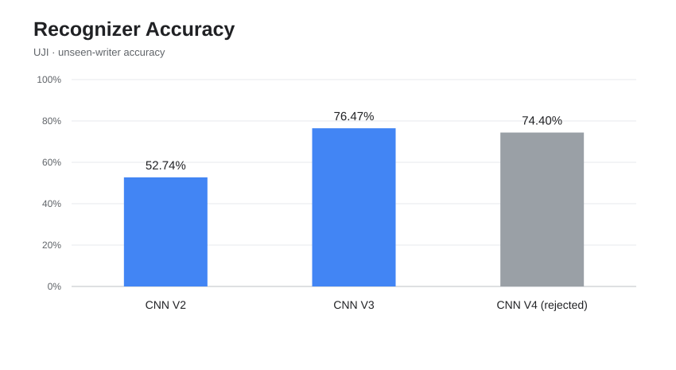
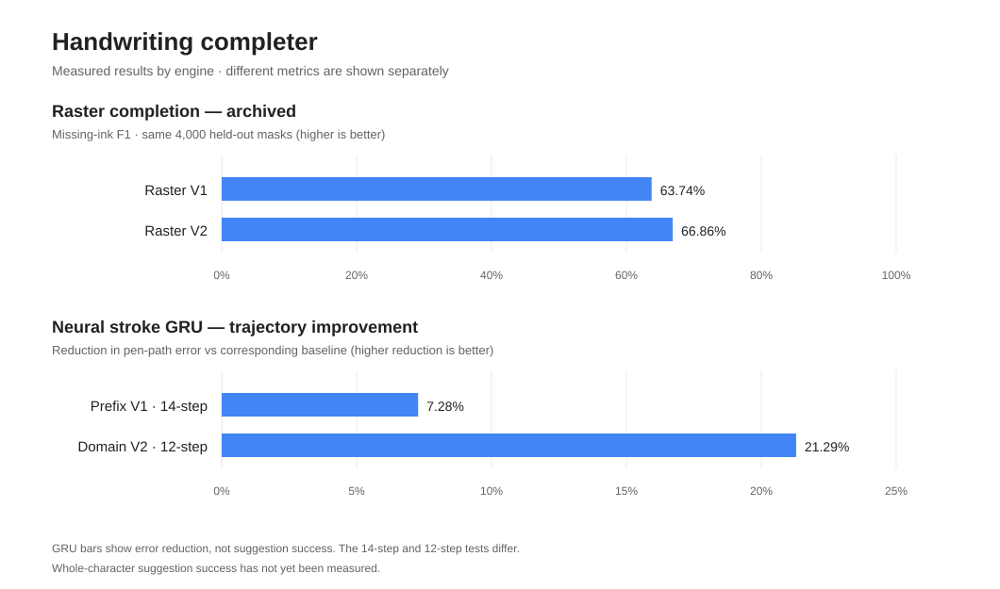

# INK AI

**Handwriting recognition and live character completion.**

A small browser-based drawing app for writing letters, numbers, and symbols. Draw on the canvas to see what INK AI recognizes, or enable Assist to preview how a character might continue.

**Made by [PletzelOnYT](https://github.com/PletzelOnYT).**

## Try it

**[Download index.html](./index.html)** and open it in Chrome or another modern browser.

It's a single HTML file that works offline. The character recognizer, stroke prediction models and English word list are built in. No account, API key or server required.

## Features

- **Live recognition** — identifies handwritten letters, numbers, punctuation, and common math symbols.
- **Pen and eraser** — a simple canvas without extra menus.
- **Assist** — optional translucent line suggestions that update while you're drawing.
- **Stroke continuations** — the assistant draws light-gray, semi-transparent extensions of your actual ink. It does not overlay printed letters.
- **Multi-stroke characters** — handles separate strokes in characters like `+`, `=`, `:`, and `X`.
- **Local drawing controls** — suggestions don't modify the actual drawing until you accept them.

### Controls

| Control | Action |
| --- | --- |
| Pen | Draw |
| Eraser | Erase |
| ✨ Assist | Toggle character suggestions |
| Tab | Switch between available suggestions |
| G / Enter | Accept the suggested strokes |
| Cmd+Z / Ctrl+Z | Undo |
| Escape | Clear the canvas |

## How it works

INK AI has two separate models:

**Recognition — a real CNN, not nearest-template matching.** The recognizer runs **three learned convolutional layers and two learned fully connected layers**, trained on real handwritten characters. It converts your ink into a 32 × 32 input, performs neural-network inference, and predicts probabilities for letters, digits, and symbols. The current released V3 CNN was adapted to real pen-drawn characters. It **does not** look through a gallery of stored letter images and choose the closest match. Decoding a neural network's predicted probabilities into a character is normal AI classification.

**Completion — a real generative GRU, not a font or curve lookup.** A trained gated recurrent unit (GRU) predicts the next pen-coordinate changes and pen-up/pen-down states conditioned on the strokes you've drawn. It samples genuine neural vector trajectories, ranks them with geometric and recognition checks, and displays the chosen strokes in translucent gray. The original black ink is preserved. It is a separate model from the CNN; it is **not ChatGPT** and has not achieved human-level handwriting completion accuracy.

Assist uses multiple candidate trajectories and filters out implausible shapes. It can use a built-in English word-frequency list to choose between genuinely plausible letters in a word, while leaving strongly recognized strokes alone. It does not force a tail onto a lowercase h that already reaches its baseline. It also takes the full-character recognition result into account, so a partial-stroke prediction doesn't override a more reliable whole-character guess. If the newer completion model can't produce a usable continuation, it can fall back to the previous trained stroke model.

The models run in browser workers and are embedded in the HTML, so it works without network access. Drawings stay in the canvas unless you choose to accept a suggestion.

## Model performance & version history

The graphs below use **measured evaluation results**, rather than invented success rates. A higher version number does not automatically mean a more accurate model. Only evaluated improvements are highlighted; rejected experiments are labeled instead of portrayed as successful upgrades.

### Character recognition — CNN

| Version | Benchmark | Measured result | Status |
| --- | --- | --- | --- |
| **CNN V1** | EMNIST ByClass, 116,323 test characters | **84.90%** overall; **48.00%** lowercase macro accuracy | Historical |
| **CNN V2** | Same EMNIST test | **84.32%** overall; **58.66%** lowercase macro accuracy | Superseded |
| **CNN V2** | UJI pen strokes, 1,551 unseen-writer characters | **52.74%** character accuracy | Superseded |
| **CNN V3** | Same UJI unseen-writer test | **76.47%** character accuracy (**+23.73 percentage points**) | **Current release** |
| **CNN V4 experiment** | Same UJI unseen-writer test | **74.40%** character accuracy | **Rejected; not shipped** |

The lowercase V1 → V2 comparison uses the same EMNIST evaluation and shows the improvement in *mean per-class lowercase accuracy*, despite a small decrease in total accuracy. V2 → V3 uses the same *independent UJI writers*. These are different benchmarks, so the results must not be connected into a single accuracy trend. The V3 EMNIST evaluation uses a different 12,000-image subset and isn't plotted beside the 116,323-image test as though identical.

**Evidence:** [V1 test and per-class scores](./models/recognition-v2-metrics.json) · [V2/V3 independent-writer evaluation](./models/recognition-v3-metrics.json) · [V4 experimental evaluation, rejected](https://github.com/PletzelOnYT/INK-AI/blob/feature/recognition-multidataset-v4/models/recognition-v4-metrics.json).

### Neural stroke completion — GRU, plus earlier raster experiments

| Engine/version | Measured benchmark | Result | Status |
| --- | --- | --- | --- |
| Raster completion V1 | Missing-ink F1, same 4,000 held-out glyph masks | **63.74% F1** | Archived; **not** the live completer |
| Raster completion V2 | Identical held-out glyph masks | **66.86% F1** (**+3.11 points**) | Archived; **not** the live completer |
| Neural stroke GRU V1 | 14-step rollout position error on unseen writers | **0.2112** (lower is better) | Base model |
| Neural stroke Prefix V1 | Same 14-step rollout evaluation | **0.1958** (**7.28% less error**) | Superseded |
| Neural stroke Prefix-Domain V2 | 12-step prefix-framed rollout on unseen writers | **0.3336** vs **0.4238** baseline (**21.29% less error**) | **Current live generator** |
| Larger stroke GRU V2 | Held-out trajectory likelihood and pen-lift tests | Did **not** beat release baseline | Rejected |
| Pen-lift V3 experiment | Unseen-writer pen-lift detection | **3.23% F1**, with many false positives | Rejected |

**Critical distinction:** A **trajectory-error reduction** tells us that generated coordinates got closer to recorded pen paths on a particular test. It is **not a percent of correct suggestions**. The two GRU error-reduction numbers also come from different evaluations (14-step and 12-step), so they are not directly additive. The deployed prefix-domain model's separate pen-lift detection test scored **0% F1**, highlighting a remaining weakness. High ordinary pen-down accuracy must not be advertised as successful pen-lift prediction.

**Evidence:** [Raster head-to-head](./models/glyph-completion-comparison.json) · [GRU Prefix V1, 14-step test](./models/stroke-prefix-metrics.json) · [GRU Prefix-Domain V2, 12-step test](./models/stroke-prefix-domain-v2-metrics.json) · [Larger GRU V2 rejection](./models/stroke-sequence-v2-metrics.json) · [Pen-lift V3 rejection](./models/penlift-v3-metrics.json).

### Training data and honest evaluation

The recognition CNN is trained from scratch on EMNIST handwritten characters, then fine-tuned on additional handwriting from UJI. The model learns its convolutional filters and classification weights through backpropagation; it does not use static glyph templates. A separate experimental training pipeline also evaluates HASYv2 handwriting and UCI PenDigits, but a checkpoint that performs worse on independent writers is **not** released.

The GRU stroke generator is trained on [UJI Pen Characters v2](https://archive.ics.uci.edu/dataset/177/uji+pen+characters+version+2), including real ordered pen movements. Additional symbols use explicitly labeled synthetic training examples, distinct from human-written samples. The user-facing gray suggestions remain learned neural pen trajectories, **not** perfect-font replacements.

Training more examples can help, but no model here is flawless. The next important benchmark is a **whole-character suggestion acceptance/correctness rate**, measured on handwriting from writers excluded from training; that number does not yet exist, so the README intentionally does not invent one.

## Project files

| File | Purpose |
| --- | --- |
| [index.html](./index.html) | Standalone drawing app |
| [src/stroke_assist_ui.js](./src/stroke_assist_ui.js) | Live gray neural pen suggestions, English context and drawing controls |
| [src/stroke_worker.js](./src/stroke_worker.js) | Neural stroke generation |
| [src/train.py](./src/train.py) | Character recognition training |
| [src/train_recognition_v3.py](./src/train_recognition_v3.py) | Current pen-adapted V3 CNN training |
| [V4 training experiment](https://github.com/PletzelOnYT/INK-AI/blob/feature/recognition-multidataset-v4/src/train_recognition_v4.py) | Experimental four-dataset recognizer training |
| [src/train_stroke_sequence.py](./src/train_stroke_sequence.py) | Stroke-model training |
| [src/train_prefix_completion.py](./src/train_prefix_completion.py) | Partial-character fine-tuning |
| [models/](./models) | Model weights and evaluation results |
| [docs/recognition-progress.svg](./docs/recognition-progress.svg) | Recognition benchmark graph |
| [docs/completion-progress.svg](./docs/completion-progress.svg) | Completion benchmark graph |
| [tests/](./tests) | Browser and model regression tests |

## Testing

[GitHub Actions](./actions/workflows/verify.yml) runs JavaScript checks, model tests, and real Chrome tests for the drawing board. The test suite covers live suggestions while drawing, multi-stroke recognition, model loading from a downloaded HTML file, and completion of characters such as lowercase `h`.

## Known limitations

Handwriting can be ambiguous, especially similar characters such as `I`, `l`, and `1`. Assist can also guess the wrong completion for unusual writing styles or incomplete strokes. Multi-character cursive writing is still a work in progress.

## Dataset credits

- [UJI Pen Characters v2](https://archive.ics.uci.edu/dataset/177/uji+pen+characters+version+2) — Prat, Castro, Llorens, Marzal, and Vilar (2008), [DOI: 10.24432/C5FG8S](https://doi.org/10.24432/C5FG8S), CC BY 4.0.
- EMNIST ByClass — handwriting recognition training data.

- [google-10000-english](https://github.com/first20hours/google-10000-english) — frequency-ordered English word list used for optional letter context.
