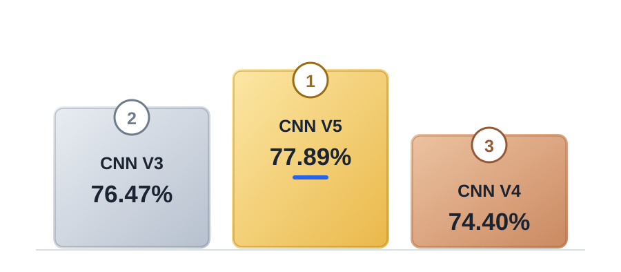
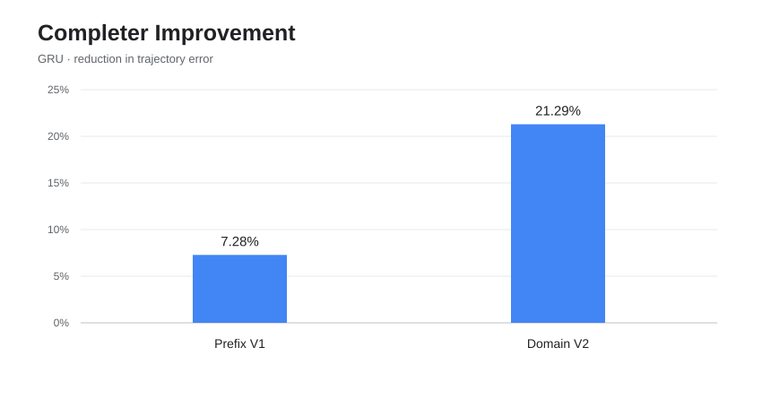

# INK AI

**Handwriting recognition and live character completion.**

A small browser-based drawing app for writing letters, numbers, and symbols. Draw on the canvas to see what INK AI recognizes, or enable Assist to preview how a character might continue.

**Made by [PletzelOnYT](https://github.com/PletzelOnYT).**

## Try it

**[Download index.html](./index.html)** and open it directly in Chrome, including offline. It includes the interface, JavaScript, and trained model weights in one file. No installation, API key, or separate assets required.

The source code is stored in GitHub: edit the [small HTML shell](./src/index.shell.html), [CSS](./src/app.css), and [JavaScript](./src/app.js). The full `index.html` is generated from these files and the trained models. GitHub excludes this generated file from the source-language percentages, but it remains available to download and run offline. To rebuild it, run `npm install --no-audit --no-fund --ignore-scripts && npm run build:ocr && python3 scripts/build_standalone.py`; GitHub Actions also [regenerates the repository root `index.html`](./.github/workflows/package-offline.yml) when source changes. It is checked into GitHub, not only stored as an artifact.

## Camera OCR — entirely in this HTML

Click the **Camera** button in the normal [index.html](./index.html) downloaded from this GitHub repo. **Press C to freeze the exact current webcam frame** (including its existing text/highlights), and press **C again to resume**. Camera is its own selected tool: Pen, Eraser and Assist are deselected while it is active, and your previous drawing tool is restored when you exit. Switching to another browser tab does **not** close Camera; scanning suspends in the background and resumes when you return without another camera-permission request. No localhost server, Mac app, Python, login, API key, extension, internet connection, or separate installation is required. The webcam preview stays live, and white see-through highlights are drawn on the printed words it detects.

The production HTML bundles a **real, pretrained English OCR engine** (Tesseract.js + Tesseract WebAssembly + English LSTM data) directly into the same file. These are Apache-2.0-licensed, open-source components from the Tesseract project, not INK AI's own trained recognition weights. They are downloaded by **GitHub Actions only while building** this repository; the shipped HTML contains all scripts, WebAssembly and traineddata and makes **no model or OCR network requests** while running. The handwriting Recognizer and neural stroke Completer are still INK AI's own models.

To rebuild the standalone HTML from source, use `npm install --no-audit --no-fund --ignore-scripts && npm run build:ocr && python3 scripts/build_standalone.py`. Then copy `dist/ink-ai-standalone.html` to `index.html`. GitHub Actions regenerates and commits the root HTML automatically on relevant source changes.

**Performance:** the camera video runs at its native frame rate. Text recognition works asynchronously in a Web Worker and processes the newest frame **after** each recognition is finished, rather than queuing stale frames. The OCR inference rate will be slower than the camera's display frame rate, especially on older hardware. This is a substantial engine upgrade for printed labels, documents, and brand names, not a verified Apple Live Text-equivalent result. Handwritten and highly distorted text may still be unreliable. When ordinary OCR has trouble, INK AI now estimates the printed line's **rotation from its actual pixels**, straightens a separate working image, and uses the corrected quadrilateral to highlight the word on the original webcam view. This covers moderate diagonals and completely sideways/upside-down text rather than just fixed 90° turns. Dark signs are normalized without changing the camera preview; repeated frames reuse a verified orientation. Upright text still takes the original fast path. [Offline Chrome oblique-text stress test](./tests/camera-oblique-browser.py) checks **20 rotated/color fixtures** (including 12°, 20°, 30°, 45°, 60°, 75°, 90°, 135°, and 180°) and negative-polarity signs, with [actual results](./docs/offline-ocr-acceptance.md). This does not guarantee perfect reading of tiny, curved, blurred, highly perspective-warped, or handwritten text on a real webcam. Text below the video represents current visible words, not an accumulating history. The camera transcript now uses **word-box geometry, punctuation spacing, Tesseract paragraph metadata, and physical line-wrap detection** to display readable paragraphs rather than one oversized line or an arbitrary newline per OCR line. Addresses, headings, forms, and separate columns keep appropriate breaks; wrapped sentences are joined when supported by page geometry. This does not hallucinate punctuation or rewrite the OCR words.

**False-positive filtering:** OCR guesses are checked against the actual pixels inside their word boxes. Flat walls, smooth skin, and isolated furniture edges do not contain the repeated sharp stroke edges expected from readable print, so those guesses are suppressed. Uncertain word readings must also agree across consecutive frames at the same screen position. This is a visual check, not a face or person detector; it does not classify or store the people in the camera. It is validated against generated plain-wall, smooth-shoulder, shelf-edge and genuine printed-label fixtures, not yet a measured real-webcam false-positive rate.

## Features

- **Live recognition** — identifies handwritten letters, numbers, punctuation, and common math symbols.
- **Pen and eraser** — a simple canvas without extra menus.
- **Camera text reader** — click the camera button to replace the whiteboard with a live webcam view and see recognized printed words and sentences below it. Uses the **bundled, offline Tesseract WebAssembly OCR engine** for general printed text, with INK AI's own CNN/line recognizer as a fallback. Recognized word boxes receive translucent white highlights; camera images are processed on your device.
- **Assist** — opt-in neural handwriting suggestions while drawing, controlled by the Assist button.
- **Stroke continuations** — the assistant draws light-gray, semi-transparent extensions of your actual ink. It does not overlay printed letters.
- **Multi-stroke characters** — handles separate strokes in characters like `+`, `=`, `:`, and `X`.
- **Local drawing controls** — suggestions don't modify the actual drawing until you accept them.
- **Personalized neural ranking** — the small on-device neural critic learns from suggestions you accept with G, compares real GRU candidates, and remembers only its learned numerical weights on your device. No handwritten ink is stored as training data.

### Controls

| Control | Action |
| --- | --- |
| Pen | Draw |
| Eraser | Erase |
| Camera | Toggle webcam text recognition; press again to restore the whiteboard |
| C (Camera active) | Freeze or resume webcam image and recognition |
| ✨ Assist | Toggle character suggestions |
| Tab | Switch between available suggestions |
| G | Accept a quality-checked neural continuation and teach the local preference ranker |
| Shift+Alt+R | Reset local learned suggestion preferences |
| Cmd+Z / Ctrl+Z | Undo (a whole accepted completion at once; also reverses its learning reward) |
| Escape | Clear the canvas |

## How it works

INK AI has two separate models:

**Recognition — a real CNN, not nearest-template matching.** The recognizer runs **three learned convolutional layers and two learned fully connected layers**, trained on real handwritten characters. It converts your ink into a 32 × 32 input, performs neural-network inference, and predicts probabilities for letters, digits, and symbols. The downloadable CNN is selected from the released V3 and any independently validated newer model; its exact version is in the deployed-model manifest. It **does not** look through a gallery of stored letter images and choose the closest match. Decoding a neural network's predicted probabilities into a character is normal AI classification.

**Completer runtime update:** The released neural generator now evaluates fewer but still genuine GRU rollouts, reducing unnecessary repeated inference. On an unfinished lowercase `h` fixture, the same local V8 test took approximately **3.3 seconds before** and **1.2 seconds after** the change (single run; not a benchmark across devices). The input builder now centers strokes using the same normalized scale as the model's training examples, keeps all strokes during dense input, and avoids merging adjacent letters into one glyph. Tests: [input grouping](./tests/completer-input-regression.mjs) and [actual neural rollout](./tests/completer-fast-quality.mjs). This is a runtime improvement, **not a claim of better overall handwriting accuracy**.

**Latest completer fix — no more fake straight-ray suggestions:** The released GRU sometimes chose high-probability straight strokes even when they made the handwritten letter worse. Its new [trajectory test](./tests/completer-no-straight-rays.mjs) rejects unsupported straight rays, bad curves, and missing crossing pen-lifts *before* displaying them; it never draws replacement font or template geometry. For round glyphs, it can use a genuinely curved neural continuation from the bundled earlier V1 GRU when V2 fails, preserving only a useful part of the actual learned stroke before it degenerates into a long tail. In a controlled unfinished-`o` test this recovered an 11-point curved stroke. The unfinished `h` still produces a descending neural continuation. An `x` is deliberately left without a suggestion if neither model makes the needed pen-lift crossing stroke. The independent recognition model also rejects candidates that make existing handwriting less recognizable. Old previews disappear when no valid result survives. Only **G** accepts a suggestion; **Enter** does not. Accepted vector ink uses the same width as the original pen. This makes the existing assistant less damaging; **it does not make every unfinished character completable**.

**Training evidence and V7 experiment:** The previous [V6 attempt](./models/stroke-prefix-domain-v6-metrics.json) **failed** independent-writer evaluation: its recorded pen-lift F1 and stop-event F1 were both zero, so those weights were not published. [V7 training](./src/train_completer_v7.py) instead supervises every real next-stroke pen-lift and end-of-character event, with additional emphasis on rare transitions. The [V7 GitHub workflow](./.github/workflows/train-completer-v7.yml) measures future-stroke accuracy, pen lifts, and termination on unseen writers and requires real browser tests, including an actual lifted crossing stroke for `x`. No V7 weights are released unless all acceptance gates pass, and no accuracy improvement or new graph is claimed without results.

**Completion — a real generative GRU, not a font or curve lookup.** A trained gated recurrent unit (GRU) predicts the next pen-coordinate changes and pen-up/pen-down states conditioned on the strokes you've drawn. It samples genuine neural vector trajectories, ranks them with geometric and recognition checks, and displays the chosen strokes in translucent gray. The original black ink is preserved. It is a separate model from the CNN; it is **not ChatGPT** and has not achieved human-level handwriting completion accuracy.

Assist uses multiple candidate trajectories and filters out implausible shapes. It can use a built-in English word-frequency list to choose between genuinely plausible letters in a word, while leaving strongly recognized strokes alone. It does not force a tail onto a lowercase h that already reaches its baseline. It also takes the full-character recognition result into account, so a partial-stroke prediction doesn't override a more reliable whole-character guess. If the newer completion model can't produce a usable continuation, it can fall back to the previous trained stroke model.

The fallback experimental INK AI camera pipeline is an entirely local, first-party pipeline: component-based RGB text localization, automatic line deskew, an independently trained printed-letter CNN, optional **native text-versus-background CNN**, multi-frame glyph-probability fusion, calibrated dictionary correction, spatial word voting, and a scene-change monitor. The textness CNN is trained from scratch on generated printed words and generated clutter (cabinet edges, stripes, boxes and reflections); its independently tested weights are published into the standalone HTML only if synthetic validation passes. The printed-letter CNN is also trained from scratch. **Those fallback INK AI models are first-party.** The new primary offline OCR engine instead uses a disclosed, bundled third-party open-source Tesseract model. Neither path uses a remote recognition API, camera upload or video recording. Synthetic validation does not establish real-webcam accuracy.

**Custom fallback camera OCR remains experimental.** The 83.69% synthetic printed-character benchmark does not measure live-photo word accuracy. The new textness CNN has a separate synthetic hard-negative benchmark in `models/camera-textness-v1-metrics.json` when training qualifies it; real camera false-positive rate remains unmeasured. A trained region verifier can improve filtering, but cannot guarantee flawless handwriting, small print, perspective, glare or unusual fonts.

The camera reader includes a **small-print document detection path** verified against the camera-resolution version of an actual user-supplied document screenshot (the screenshot is not committed). If detected letters are too small, camera mode can automatically switch from 800px processing to a sharper 1200px capture. The existing character reader still combines predictions across consecutive frames.

A separately trained **native CNN–bidirectional-GRU–CTC line recognizer** is now implemented in `src/camera_line_runtime.js`. Unlike the isolated-character CNN, it reads connected printed text as a sequence, including spaces, short abbreviations, labels, addresses and unfamiliar words. It is trained from scratch on locally rendered system fonts and independent held-out font families by `src/train_camera_line_ctc.py`; the benchmark record is `models/native-line-ctc-v1-metrics.json`. **Until the workflow publishes a validated checkpoint, camera mode continues using the previous character reader.** Synthetic evaluation is not real-webcam accuracy. No pretrained third-party model or external OCR API is used. It keeps **the current document's** words in reading order rather than concatenating guesses from every previous frame. Temporary blurring is tolerated, but a removed document or visibly changed camera scene clears the old reading. The white highlighter appears only on confidently recognized words, not on hair, clothing, shelving or other text-shaped objects. This pipeline is still limited by the quality of the local trained models; it is not guaranteed instantaneous or perfectly accurate.

The source app loads local model files and runs inference entirely in browser workers. The packaged offline build embeds the same model data. Drawings stay in the canvas unless you accept a suggestion.

## Model graphs

### Recognizer

### Completer

**Graph update rule:** Keep the two original graphs, but show **every recorded version** of the corresponding model, including unsuccessful experiments. Recognizer bars are UJI unseen-writer accuracy (higher is better); Completer bars are independently evaluated free-running trajectory error (lower is better). Different metrics such as pen-lift F1 are **not** presented as trajectory error. Missing results appear as *no score*, never invented percentages. Gray experimental/rejected bars do not mean a checkpoint was released. The charts are regenerated from checked-in benchmark JSON by `python3 scripts/update_model_graphs.py` whenever models are packaged or V7 training publishes a result.

**Which models does the downloadable HTML actually run?** See the generated [deployed-model manifest](./docs/current-models.json). It is produced with `index.html` from the exact CNN and GRU weights selected during that build. The graphs also show rejected and unverified experiments, which are **not** necessarily enabled. V5 CNN is promoted only after real offline Chrome acceptance, and V7 GRU only after unseen-writer, pen-lift, termination and browser acceptance.

### Training data and honest evaluation

The recognition CNN is trained from scratch on EMNIST handwritten characters, then fine-tuned on additional handwriting from UJI. The model learns its convolutional filters and classification weights through backpropagation; it does not use static glyph templates. A separate experimental training pipeline also evaluates HASYv2 handwriting and UCI PenDigits, but a checkpoint that performs worse on independent writers is **not** released.

The GRU stroke generator is trained on [UJI Pen Characters v2](https://archive.ics.uci.edu/dataset/177/uji+pen+characters+version+2), including real ordered pen movements. Additional symbols use explicitly labeled synthetic training examples, distinct from human-written samples. The user-facing gray suggestions remain learned neural pen trajectories, **not** perfect-font replacements.

Training more examples can help, but no model here is flawless. The next important benchmark is a **whole-character suggestion acceptance/correctness rate**, measured on handwriting from writers excluded from training; that number does not yet exist, so the README intentionally does not invent one.

### Recognition improvement target

The experimental V5 training focused on confusion between `1`, `I`, `l`, `i`, `j`, and `t`. V3 remains the safe fallback; V5 is bundled as the default only after its real browser acceptance report is published. It checks held-out pen writers and does not deploy a model just because it completed training. **90% accuracy remains a target, not a measured result.**

## Project files

| File | Purpose |
| --- | --- |
| [index.html](./index.html) | Downloadable self-contained HTML — works offline |
| [src/index.shell.html](./src/index.shell.html) | Small editable HTML template |
| [src/app.js](./src/app.js) | In-browser recognizer and drawing controller |
| [src/camera_ocr.js](./src/camera_ocr.js) | Permission-based live camera OCR |
| [src/app.css](./src/app.css) | Interface styles |
| [scripts/build_standalone.py](./scripts/build_standalone.py) | Generate the complete offline HTML |
| [data/english-words.txt](./data/english-words.txt) | Optional word context |
| [src/stroke_assist_ui.js](./src/stroke_assist_ui.js) | Live gray neural pen suggestions, English context and drawing controls |
| [src/stroke_worker.js](./src/stroke_worker.js) | Neural stroke generation |
| [src/train.py](./src/train.py) | Character recognition training |
| [src/train_print_cnn.py](./src/train_print_cnn.py) | First-party printed-font CNN training, separate held-out families |
| [src/train_camera_line_ctc.py](./src/train_camera_line_ctc.py) | Train native sequence OCR with withheld font-family benchmarks |
| [src/camera_line_runtime.js](./src/camera_line_runtime.js) | Run native CNN–BiGRU–CTC line inference in a browser Worker |
| [src/train_camera_textness.py](./src/train_camera_textness.py) | Native text/background CNN trained against generated room clutter |
| [src/camera_tracking.js](./src/camera_tracking.js) | Multi-frame character probabilities, scene changes and word tracking |
| [src/camera_text_detector.js](./src/camera_text_detector.js) | Connected-component printed-text localization |
| [src/train_recognition_v3.py](./src/train_recognition_v3.py) | Released pen-adapted V3 CNN training |
| [src/train_recognition_hardcases.py](./src/train_recognition_hardcases.py) | New confusing-character V5 training |
| [V4 training experiment](https://github.com/PletzelOnYT/INK-AI/blob/feature/recognition-multidataset-v4/src/train_recognition_v4.py) | Experimental four-dataset recognizer training |
| [src/train_stroke_sequence.py](./src/train_stroke_sequence.py) | Stroke-model training |
| [src/train_prefix_completion.py](./src/train_prefix_completion.py) | Partial-character fine-tuning |
| [models/](./models) | Model weights and evaluation results |
| [docs/recognition-progress.svg](./docs/recognition-progress.svg) | Recognition benchmark graph |
| [docs/completion-progress.svg](./docs/completion-progress.svg) | Completion benchmark graph |
| [tests/](./tests) | Browser and model regression tests |

## Testing

[GitHub Actions](./actions/workflows/verify.yml) runs JavaScript checks, model tests, and real Chrome tests for the drawing board. The test suite covers live suggestions while drawing, multi-stroke recognition, model loading from a downloaded HTML file, and completion of characters such as lowercase `h`.

### Larger handwriting model experiment

A separate training experiment uses **Google Research InkSight's released vector outputs** as an *unlabelled pen-motion teacher*, then learns letters from real UJI pen recordings using a larger 384-unit GRU. It does **not** copy Google's pretrained weights or use a remote API in the app. Only a candidate that improves unseen-writer continuation accuracy, pen lifts and JavaScript inference speed can be published; the downloaded `index.html` still runs the proven smaller model. [Training evidence](./actions/workflows/train-google-teacher-big.yml) · [Google InkSight source](https://github.com/google-research/inksight).

**Model experiments:** New GRU checkpoints are trained on writer-disjoint pen data and compared with the released model. A V4 curriculum emphasizes difficult partial letters and early stroke motion; only independently improved, offline-browser-tested weights can replace the downloadable model. Training a candidate does not mean it has been deployed.

## Known limitations

Handwriting can be ambiguous, especially similar characters such as `I`, `l`, and `1`. Assist can also guess the wrong completion for unusual writing styles or incomplete strokes. Multi-character cursive writing is still a work in progress.

## Dataset credits

- [Google Research InkSight](https://github.com/google-research/inksight) and its [InkSight-Derenderings dataset](https://huggingface.co/datasets/Derendering/InkSight-Derenderings) — Apache-2.0 model-produced InkML trajectories for experimental unlabelled motion pretraining; **not** handwritten letter ground truth.
- [UJI Pen Characters v2](https://archive.ics.uci.edu/dataset/177/uji+pen+characters+version+2) — Prat, Castro, Llorens, Marzal, and Vilar (2008), [DOI: 10.24432/C5FG8S](https://doi.org/10.24432/C5FG8S), CC BY 4.0.
- EMNIST ByClass — handwriting recognition training data.

- [google-10000-english](https://github.com/first20hours/google-10000-english) — frequency-ordered English word list used for optional letter context.
